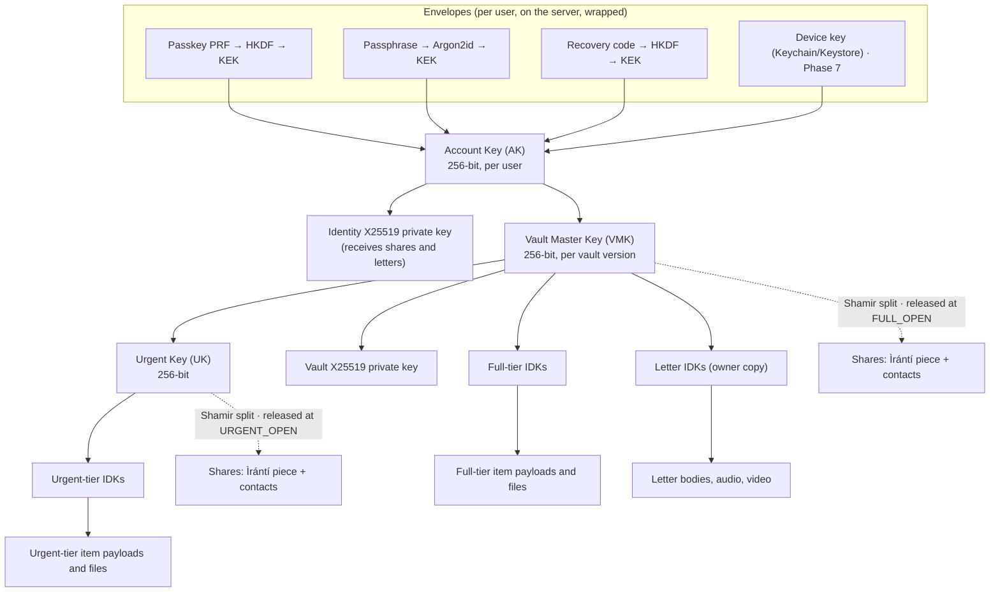
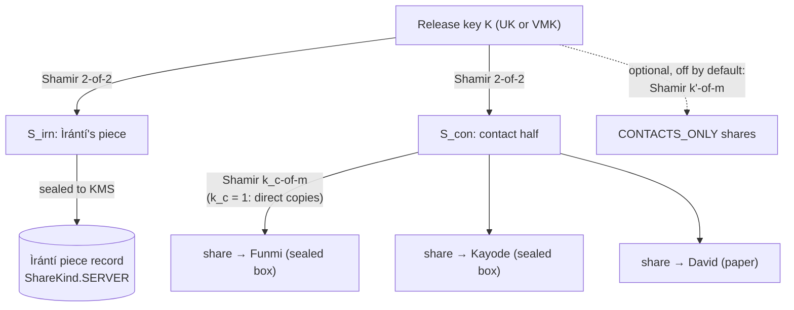

# Ìrántí cryptography

**Status:** design for external review · v0.1 · Phase 0 · 16 October 2026
**Source of truth:** BUILD.md §8, refined here. Where this document differs from BUILD.md, the
difference is listed in §12 and in `PROGRESS.md` for approval.
**Code:** all of it lives in `packages/crypto`. Nothing else in the repo may import a
cryptographic library (enforced by ESLint).

---

## 1. Goals and non-goals

### 1.1 Security goals

| #   | Goal                                                                                                                                                                                                                                     |
| --- | ---------------------------------------------------------------------------------------------------------------------------------------------------------------------------------------------------------------------------------------- |
| G1  | **Confidentiality against COTEK.** A complete copy of the database and object storage, together with every key COTEK holds (including KMS), does not let anyone decrypt any vault item, file, letter, letter question or claim evidence. |
| G2  | **No single party can release a vault.** Not COTEK, not one trusted contact, not one executor (under the default configuration).                                                                                                         |
| G3  | **Tiered release.** Opening the urgent tier reveals nothing in the full tier.                                                                                                                                                            |
| G4  | **Integrity and binding.** Any modification of a ciphertext, or moving it to another item, vault, revision, tier or purpose, is detected on decryption.                                                                                  |
| G5  | **Separation of roles.** Releasing a person's own vault never exposes the key shares they hold for other people.                                                                                                                         |
| G6  | **Letters reach only their recipient.** A letter is readable only by its owner and by the holder of the recipient's key or letter card (or, for hand-over letters, the executor's device, which the owner is told plainly).              |
| G7  | **No early opening of dated letters.** A date-gated letter cannot be opened before its date by anyone, COTEK and the recipient included.                                                                                                 |

### 1.2 What the cryptography does not do (enforced elsewhere, or residual)

- **Release timing is enforced by the server, not by cryptography.** The waiting periods
  and confirmation counts of §9 of BUILD.md decide when COTEK releases its piece. A malicious
  COTEK could release its piece early, but it still needs an executor's share (G2). See
  THREAT_MODEL.md §4.1.
- **Release-gated letters** (`ON_RELEASE`, `RELEASE_PLUS`, `MILESTONE`) are held back by the
  server. Their confidentiality against everyone except the recipient is cryptographic; their
  timing is not. Only `FIXED_DATE` letters are timelocked.
- **Web code delivery.** The hosted PWA's JavaScript is served by COTEK. A malicious deploy
  could exfiltrate keys from a browser that loads it. Native apps (bundled, store-reviewed)
  narrow this; the web cannot fully close it. See THREAT_MODEL.md §4.8.
- **Metadata** is visible to COTEK: who has an account, who their trusted contacts are, item
  counts per section and tier, sizes (padded, §4.3), timings and release events.
- **A compromised device** of the owner, executor or recipient is out of scope.

---

## 2. Primitives

All via `libsodium-wrappers-sumo` 0.8.4 unless stated. No hand-rolled primitives.

| Use                                       | Primitive                                                                               | Parameters                                     |
| ----------------------------------------- | --------------------------------------------------------------------------------------- | ---------------------------------------------- |
| Symmetric encryption and key wrapping     | XChaCha20-Poly1305-IETF (`crypto_aead_xchacha20poly1305_ietf_*`)                        | 256-bit key, 192-bit random nonce, 128-bit tag |
| Public-key encryption to a person         | Sealed box (`crypto_box_seal`): X25519 + XSalsa20-Poly1305                              | Ephemeral sender key per message               |
| Passphrase → key                          | Argon2id (`crypto_pwhash`, `ALG_ARGON2ID13`)                                            | §3.2.2; parameters stored per envelope         |
| Key derivation from high-entropy input    | HKDF-SHA-256 (`crypto_kdf_hkdf_sha256_*`, or WebCrypto HKDF)                            | Domain-separated `info` strings, §3.2          |
| Fingerprints and commitments              | BLAKE2b-256 (`crypto_generichash`), keyed with a domain label                           | §5.4                                           |
| Audit hash chain                          | SHA-256 (`crypto_hash_sha256`)                                                          | §8                                             |
| Secret sharing                            | Shamir over GF(2⁸): `shamir-secret-sharing` 0.0.4 (Privy; audited by Cure53 and Zellic) | §5                                             |
| Timelock                                  | `tlock-js` 0.9.0 (drand IBE over BLS12-381, age format)                                 | drand quicknet, §7.3                           |
| Passkey-derived key                       | WebAuthn PRF extension (HMAC-SHA-256 inside the authenticator)                          | §3.2.1                                         |
| Server-side protection of Ìrántí's pieces | AWS KMS (or Google Cloud KMS)                                                           | §5.3                                           |
| Randomness                                | `randombytes_buf` → `crypto.getRandomValues`                                            |                                                |
| Secret comparison                         | `sodium.memcmp` (constant time)                                                         |                                                |

**Why XChaCha20-Poly1305:** 192-bit nonces make random nonces safe for the life of a key
(no counter state to keep across devices), and it is constant-time in WASM without AES-NI.

---

## 3. Keys

### 3.1 Key hierarchy



| Key                    | Size / type | Generated                    | Wrapped by / stored as                                        | Rotates                                  |
| ---------------------- | ----------- | ---------------------------- | ------------------------------------------------------------- | ---------------------------------------- |
| Account Key (AK)       | 256-bit     | User's device, at sign-up    | Each envelope's KEK (`AccountEnvelope.wrappedKey`)            | On demand; re-wraps envelope blobs only  |
| Identity keypair       | X25519      | User's device, at sign-up    | Private key under AK (`User.wrappedPrivKey`)                  | With AK rotation; triggers re-share      |
| Vault Master Key (VMK) | 256-bit     | Owner's device, vault create | AK (`Vault.wrappedVmk`)                                       | "Rotate vault key" (BUILD.md §8.4)       |
| Urgent Key (UK)        | 256-bit     | Owner's device, vault create | VMK (`Vault.wrappedUrgentKey`)                                | One-tap after a cancelled urgent opening |
| Vault keypair          | X25519      | Owner's device, vault create | Private key under VMK (`Vault.wrappedVaultPrivKey`)           | With VMK                                 |
| Item Data Key (IDK)    | 256-bit     | Per item, file, letter       | UK (urgent tier) or VMK (full tier); letters: VMK + recipient | Item tier change re-wraps                |
| Letter card key        | X25519      | Owner's device               | Printed only, then erased from the device                     | Reprint = new card, re-seal              |
| Envelope KEK           | 256-bit     | Derived on unlock            | Never stored                                                  | —                                        |

### 3.2 Envelopes: unlocking the Account Key

Signing in (authentication) and unlocking (decryption) are separate. A session cookie or
bearer token never reveals any key. Each envelope stores `wrappedKey = nonce ‖
AEAD(KEK, AK, AD)` with `AD = encodeAd("account.envelope", [userId, envelopeId, kind,
accountKeyVersion])`, plus non-secret `params`.

#### 3.2.1 Passkey (preferred where supported)

1. At registration the client asks for the WebAuthn `prf` extension and generates a random
   32-byte `prfSalt`, stored in `params` with the credential id.
2. On unlock: `navigator.credentials.get({ extensions: { prf: { eval: { first: prfSalt } } } })`
   returns a 32-byte PRF output computed inside the authenticator.
3. `KEK = HKDF-SHA-256(ikm = prfOutput, salt = prfSalt, info = "iranti/v1/kek/passkey" ‖ userId)`.

Support is uneven across platforms and password managers (verify the current matrix in
Phase 1). Where PRF is missing the passkey still signs in, and unlocking falls back to the
passphrase.

#### 3.2.2 Passphrase

`KEK = Argon2id(NFKC(passphrase), salt = random 16 bytes, opslimit, memlimit)`.

Proposed parameters, to be confirmed by benchmark on a low-end Android phone in Phase 1:

| Profile | opslimit | memlimit | Use                                        |
| ------- | -------- | -------- | ------------------------------------------ |
| Target  | 3        | 256 MiB  | `MODERATE`; default where the device copes |
| Floor   | 3        | 64 MiB   | Low-memory devices; never lower            |

Parameters live in the envelope's `params`, so they can be raised later by re-wrapping. The
client enforces a minimum passphrase strength (zxcvbn-style estimate) because Argon2id slows
but cannot save a weak passphrase from an offline attacker holding the database.

#### 3.2.3 Recovery code

- 160 random bits, shown once, encoded as 32 Crockford base32 characters in 8 groups of 4,
  plus one 4-character check group (first 20 bits of BLAKE2b of the code) to catch typos.
- `KEK = HKDF-SHA-256(ikm = codeBytes, salt = envelopeId, info = "iranti/v1/kek/recovery")`.
  No Argon2id: 160 bits of entropy cannot be brute-forced.
- Printed in the **Emergency Kit** PDF, generated on the device and never uploaded. The flow
  cannot finish without an explicit "I've saved or printed it" step.

#### 3.2.4 Device (native, Phase 7)

A random AK-wrapping key held in iOS Keychain / Android Keystore behind biometrics. Designed
in Phase 7.

**Loss:** if every envelope is lost, the vault is unrecoverable by design. There is no
COTEK-held envelope.

### 3.3 Why an Account Key sits above the VMK (change from BUILD.md §8.2)

BUILD.md wraps the VMK directly in envelopes and wraps the contact keypair under "this
user's account/vault key". If a person is both an owner and a trusted contact, and their
identity private key were reachable from their VMK, then releasing **their** vault to **their**
executor would hand that executor the shares they hold for **other** people's vaults. That
breaks G5 and BUILD.md §3.6 ("their own vault and the pieces they hold for others never mix").

So every user, owner or not, has one Account Key. Envelopes wrap the AK. The AK wraps the
identity private key and, for owners, the VMK. Shamir releases only the VMK and UK, never the
AK. Side benefit: rotating the VMK re-wraps one blob under the AK, not every envelope.

---

## 4. Ciphertext format and associated data

### 4.1 AEAD calls

Every AEAD call has associated data built by `encodeAd(purpose, fields)` in
`packages/crypto/src/ad.ts`. There is no API without AD.

Encoding (no delimiter ambiguity):

```
"iranti:ad:v1" 0x00
u8  len(purpose) ‖ purpose (ASCII)
for each field:
  u8  tag      0x01 UTF-8 string | 0x02 unsigned integer | 0x03 raw bytes
  u32 length   big-endian
  bytes        (integers are 8-byte big-endian)
```

Test vector (committed in `packages/crypto/test/ad.test.ts`):

```
encodeAd("item.payload", ["v1", "i1", 7])
hex    6972616e74693a61643a7631000c6974656d2e7061796c6f6164010000000276310100000002693102000000080000000000000007
base64 aXJhbnRpOmFkOnYxAAxpdGVtLnBheWxvYWQBAAAAAnYxAQAAAAJpMQIAAAAIAAAAAAAAAAc=
```

### 4.2 Purposes and their fields

| Purpose            | Protects                                | AD fields                                        |
| ------------------ | --------------------------------------- | ------------------------------------------------ |
| `item.payload`     | Vault item payload under its IDK        | vaultId, itemId, revision                        |
| `item.idk`         | IDK wrapped under UK or VMK             | vaultId, itemId, vaultVersion, tier              |
| `file.chunk`       | One chunk of an attachment              | vaultId, fileId, chunkIndex, chunkCount          |
| `letter.payload`   | Letter body under its IDK               | vaultId, letterId, revision                      |
| `letter.idk`       | Letter IDK under VMK (owner copy)       | vaultId, letterId, vaultVersion                  |
| `vault.uk`         | UK under VMK                            | vaultId, vaultVersion                            |
| `vault.vmk`        | VMK under AK                            | userId, vaultId, vaultVersion, accountKeyVersion |
| `vault.kcv`        | Key-check value (§5.4)                  | vaultId, vaultVersion, tier                      |
| `account.envelope` | AK under an envelope KEK                | userId, envelopeId, kind, accountKeyVersion      |
| `keypair.private`  | X25519 private key under its parent key | ownerId (user or vault), keyRole, version        |

Binding `tier` into `item.idk` means the server cannot present an urgent-tier wrap as a
full-tier one or vice versa. Binding `chunkIndex` and `chunkCount` stops reordering and
truncation of file chunks (the last chunk is authenticated as last).

### 4.3 Payload padding

Plaintext JSON is padded before encryption to the next bucket (256 B up to 4 KiB, then the
next power of two) so ciphertext length reveals little about content. Files are chunked at a
fixed size (proposed 1 MiB); the final chunk is padded.

### 4.4 Wrapped key encoding

Every `wrapped*` column is `base64(nonce ‖ ciphertext)`. Item and letter payloads keep the
nonce in its own column, as in BUILD.md §15.

### 4.5 Rollback (residual)

AD binds a ciphertext to its item and revision, which stops swaps. It does not stop the
server from serving an **older** revision of the same item with its matching older AD. The
client keeps the highest revision it has seen per item and warns on regression. A signed
vault manifest (per-item revision list authenticated under the VMK) is proposed for Phase 1
review.

---

## 5. Release by quorum

### 5.1 The problem with a single Shamir split (change from BUILD.md §8.4)

BUILD.md proposes one Shamir split of each release key into n shares with threshold k = 2,
where one share is Ìrántí's. With plain Shamir, **any** 2 of the n shares reconstruct the
key. As soon as an owner has two or more trusted contacts, any two contacts together could
open the vault without Ìrántí, and the "Ìrántí plus one executor" rule would not hold.

### 5.2 Composite quorum (proposed)

For each release key K ∈ {UK, VMK}, independently, on the owner's device:



1. Split K with Shamir 2-of-2 into `S_irn` (Ìrántí's piece) and `S_con` (the contact half).
2. Distribute `S_con` among the m accepted contacts with threshold `k_c`:
   - `k_c = 1` (default, "Ìrántí plus one executor"): every contact receives `S_con` sealed to
     their own key. (The library needs a threshold of at least 2, so `k_c = 1` uses direct
     copies rather than a 1-of-m split.)
   - `k_c ≥ 2`: Shamir `k_c`-of-m over `S_con`.
3. **Opening K needs `S_irn` and `k_c` contact shares.** Contacts alone never have `S_irn`.
   Ìrántí alone never has `S_con`.
4. **Continuity option (`CONTACTS_ONLY`, off by default):** a separate, direct Shamir
   `k'`-of-m split of K among contacts, with `k' ≥ 2` and an explanation that Ìrántí is no
   longer needed. Stored with `KeyShare.scheme = CONTACTS_ONLY`.

Effective guarantees under the default (`k_c = 1`):

| Who colludes                              | Can open? |
| ----------------------------------------- | --------- |
| COTEK alone (database + KMS)              | No        |
| Any number of contacts without COTEK      | No        |
| COTEK + any one contact who holds a share | **Yes**   |

The last row is inherent to "Ìrántí plus one executor". An owner who wants more protection
sets `k_c = 2`. The UI must say this plainly.

### 5.3 Ìrántí's piece

- The client encrypts `S_irn` to an **asymmetric KMS key** (RSA-4096, `RSAES_OAEP_SHA_256`)
  using its public key, so the API never sees `S_irn` at setup. The plaintext includes a
  header (vaultId, vaultVersion, tier, scheme) that the API checks after decryption, because
  asymmetric KMS keys do not support encryption context.
- The API decrypts only when the release state machine reaches `URGENT_OPEN` (UK) or
  `FULL_OPEN` (VMK), returns `S_irn` over TLS to an authenticated executor session, records a
  `piece_issued` event, and marks the issue single-use. KMS audit logs record every decrypt.
- IAM: only the release path's role may call `kms:Decrypt` on this key; no human role may.
- Symmetric KMS with encryption context is an acceptable alternative if the client sends
  `S_irn` to the API over TLS at setup. Decision for Temi (BUILD.md §19.2).

### 5.4 Share format, integrity and verification

Each share is sealed (digital) or printed (paper) as:

```
"iranti:share:v1" ‖ vaultId ‖ vaultVersion ‖ tier ‖ scheme ‖ shareIndex ‖ shareBytes
```

(fields length-prefixed as in §4.1). After opening a sealed share, the device checks every
header field against the release it is working on. Sealed boxes carry no AD, so the binding
lives in the plaintext.

- **Commitment.** `KeyShare.shareCommitment = BLAKE2b-256(key = "iranti/v1/share-commit",
header ‖ shareBytes)`. A share is 33 bytes with at least 256 bits of entropy, so the
  commitment reveals nothing usable. At reconstruction, every presented share is checked
  against its commitment first, so a corrupted or malicious share is identified, not just
  detected. Paper shares are verified the same way when scanned.
- **Key-check value.** `Vault.kcvVmk = AEAD(VMK, "iranti-kcv", AD = vault.kcv)` (and likewise
  for UK). A rebuilt key is accepted only if it opens its KCV.

### 5.5 Re-sharing and rotation

- **Contacts change:** generate fresh shares of the same K, upload, then revoke the old
  `KeyShare` rows. A removed contact's old share still combines with an old `S_irn`, so
  `S_irn` is regenerated on every re-share: old contact shares become useless once the old
  Ìrántí piece record is deleted. This relies on COTEK actually deleting it; a malicious
  COTEK that kept it is no worse off than the "COTEK + one contact" row in §5.2, and the
  for-cause path below removes even that.
- **Removed for cause:** offer "rotate vault key": new VMK (and UK), re-wrap every IDK
  (payloads untouched), re-share, bump `Vault.version`.
- **Pending contacts** get no share until they accept and their key is verified (§6.1). The
  effective quorum counts accepted, verified contacts only.

### 5.6 At release (executor's device)

1. At `URGENT_OPEN` the executor's device fetches `S_irn(UK)` and its own sealed share,
   opens the share with its identity private key, verifies commitments, combines, checks the
   KCV, and decrypts urgent-tier items in memory.
2. At `FULL_OPEN`, the same for the VMK.
3. Keys exist only in memory. Nothing is uploaded unwrapped. Offline copies are kept only as
   ciphertext plus the executor's own wraps.

---

## 6. Public-key authenticity

### 6.1 Contact keys (substitution attack)

The server hands the owner each contact's public key. A malicious server could hand over a
key it controls, receive that contact's share sealed to itself, combine it with `S_irn` and
open the vault. This is the most important attack on the design.

Mitigation (Phase 3):

1. **Invite secret.** The owner's device creates a 128-bit invite secret `s` and puts it in
   the invite link's fragment (`#s=…`, never sent to the server). The owner sends the link
   through their own channel (WhatsApp, SMS from their phone) via the share sheet. If the
   owner chooses "Ìrántí emails it", the server sees `s` and the binding is weaker; the UI
   says so.
2. The contact's device returns `pk ‖ HMAC-SHA-256(key = HKDF(s, "iranti/v1/invite"),
msg = pk ‖ vaultId ‖ contactId)`. The owner's device verifies the MAC before creating any
   share.
3. **Pinning.** The verified key is stored as `TrustedContact.pinnedPublicKeyEnc` =
   AEAD(VMK, pk, AD = contactId). Later shares are sealed only to the pinned key; a changed
   key requires re-verification.
4. **Fingerprint comparison** (safety-number style) is offered in person as an alternative
   and as a second check.

### 6.2 Recipient keys

The same invite-secret pattern applies when a recipient creates an account for a letter.
Letter cards avoid the problem entirely: their keys are made on the owner's device.

### 6.3 Ìrántí's KMS public key

Pinned in the client bundle (with its KMS key id). Substitution would only matter if it let
the server learn `S_irn`, which the server already effectively controls.

---

## 7. Letters

### 7.1 Encryption

Each letter has its own IDK. Body: `AEAD(IDK, body, AD = letter.payload)`. Audio and video use
the file-chunk format. The IDK is wrapped:

- to the owner: `AEAD(VMK, IDK, AD = letter.idk)`;
- to each recipient, per their lock:

| Lock            | Recipient wrap                                                        | Who can open                      |
| --------------- | --------------------------------------------------------------------- | --------------------------------- |
| `RECIPIENT_KEY` | `seal(recipientIdentityPk, header ‖ IDK)`                             | The recipient                     |
| `LETTER_CARD`   | `seal(cardPk, header ‖ IDK)`; card secret printed, erased             | Whoever holds the card            |
| `HANDOVER`      | none until release; then the executor's device seals to the recipient | Executor's device, then recipient |

### 7.2 Letter cards

Generated on the owner's device: X25519 keypair; secret key printed as a QR code and a word
encoding (BIP-39 English list, 24 words for 32 bytes, with checksum), then wiped from memory.
`LetterRecipient.cardFingerprint = BLAKE2b-256("iranti/v1/card", cardPk)` lets the server and
the scanning device confirm the right card without learning anything secret.

### 7.3 Date gate (timelock)

For `FIXED_DATE` letters the recipient wrap is timelocked: `tlockWrap = tlock_encrypt(round
R, seal(recipientPk, header ‖ IDK))`, where R is the first drand quicknet round at or after
the date (3-second rounds). Before round R is published, nobody can remove the timelock;
after it, the recipient still needs their key or card. drand learns nothing about the letter.

Dependency: the public drand League of Entropy network (BUILD.md §19.8). If drand stopped,
dated letters would stay locked; mitigation: the owner's VMK-wrapped copy is unaffected, and
the continuity runbook covers re-wrapping with the owner's or executor's device.

### 7.4 Personal question

`questionEnc` is sealed inside the same recipient wrap as the IDK. It is a usability check, not
a security boundary.

---

## 8. Claims, evidence and the audit chain

- **Evidence** (death certificate, hospital letter): encrypted on the claimant's device under
  a random key; that key is sealed to every accepted trusted contact's pinned identity key.
  Support never receives it unless a contact's device re-encrypts a selected document to the
  support key for a dispute.
- **Audit chain:** `hash_i = SHA-256("iranti:audit:v1" ‖ caseId ‖ seq ‖ prevHash ‖ type ‖
actorId ‖ canonicalJSON(data) ‖ createdAt(ISO-8601 UTC))`, fields length-prefixed as in
  §4.1, `canonicalJSON` per RFC 8785. Unique `(caseId, seq)` and `(caseId, prevHash)` stop
  forks in the database.
- **Anchoring (residual):** a server can rewrite its whole chain. Every client that views a
  case stores the head hash it saw; a later view whose chain does not extend a stored head
  raises an alarm. Publishing heads externally is a Phase 8 consideration.

---

## 9. Implementation rules

- All crypto in `packages/crypto`; ESLint blocks crypto imports and `crypto.subtle` elsewhere.
- Every AEAD call takes AD; there is no overload without it.
- Decryption failures throw `CryptoError` with fixed messages; nothing about inputs leaks.
- Constant-time comparison for secrets (`constantTimeEqual`).
- Best-effort wiping (`wipe`) of key buffers after use. JavaScript cannot guarantee erasure
  (copies, GC, JIT); this is a residual risk on every web client.
- Never log keys, shares, passphrases, recovery codes, tokens or plaintext: ESLint rule plus
  `scripts/check-no-secret-logs.mjs` in CI.
- Unit tests for every function, including negative tests (tampered ciphertext, nonce, AD,
  truncation, wrong key); property tests for split/combine; committed vectors.

---

## 10. Test plan (crypto)

| Phase | Tests                                                                                                                                                                                                                         |
| ----- | ----------------------------------------------------------------------------------------------------------------------------------------------------------------------------------------------------------------------------- |
| 0     | AEAD round trip with AD; tamper tests (every bit of ciphertext and tag, nonce, truncation, wrong key, AD swap across item/vault/revision/purpose); AD vector and injectivity property; library smoke tests. **Done.**         |
| 1     | Envelopes: each of passkey (mocked PRF), passphrase, recovery code unlocks independently; wrong secret fails; Argon2id parameter floor enforced.                                                                              |
| 3     | Composite quorum: `S_irn` + `k_c` contact shares rebuild; any set without `S_irn` fails; `k_c − 1` contact shares fail; commitments catch a bad share; header mismatch rejected; re-share revokes. Paper share QR round trip. |
| 4     | Letter locks; card fingerprint; tlock to a near round cannot open early (staging); hand-over re-seal.                                                                                                                         |
| 5     | **Zero-knowledge test:** given a full DB and storage dump plus every COTEK key (including KMS decrypt), an attacker harness decrypts nothing.                                                                                 |

---

## 11. Open questions for the reviewer

1. Composite 2-of-2 over `k_c`-of-m (§5.2): any weakness in composing two Shamir layers with
   this library, or in using direct copies for `k_c = 1`?
2. Is the invite-secret MAC (§6.1) enough against key substitution, given that the owner may
   choose to let COTEK deliver the invite?
3. Argon2id floor (64 MiB, t = 3) for low-end phones: acceptable?
4. Asymmetric KMS (RSA-OAEP) for Ìrántí's piece versus symmetric with encryption context.
5. Rollback protection: is a VMK-authenticated manifest worth its complexity in Phase 1?
6. tlock wrapping order (timelock outside the sealed box) and drand dependency.

---

## 12. Changes from BUILD.md §8 (for approval)

| BUILD.md                                                 | Here                                                                                    | Why                                                                 |
| -------------------------------------------------------- | --------------------------------------------------------------------------------------- | ------------------------------------------------------------------- |
| Envelopes wrap the VMK (`VaultEnvelope.wrappedVmk`)      | Envelopes wrap an Account Key; AK wraps the VMK (`AccountEnvelope`, `Vault.wrappedVmk`) | G5: releasing a vault must not expose shares held for others (§3.3) |
| One Shamir split per key, k = 2 including Ìrántí's piece | Composite: 2-of-2 (Ìrántí, contact half), contact half `k_c`-of-m                       | Plain k = 2 lets any two contacts open without Ìrántí (§5.1)        |
| AD = `vaultId \| itemId \| version`                      | Length-prefixed, purpose-separated AD with an item revision                             | Removes delimiter ambiguity and cross-purpose swaps (§4)            |
| Paper share fingerprint only                             | Commitment for every share, plus key-check values                                       | Identify a bad share, verify the rebuilt key (§5.4)                 |
| Contact public key taken from the server                 | Invite-secret MAC and pinned key                                                        | Key-substitution attack (§6.1)                                      |
